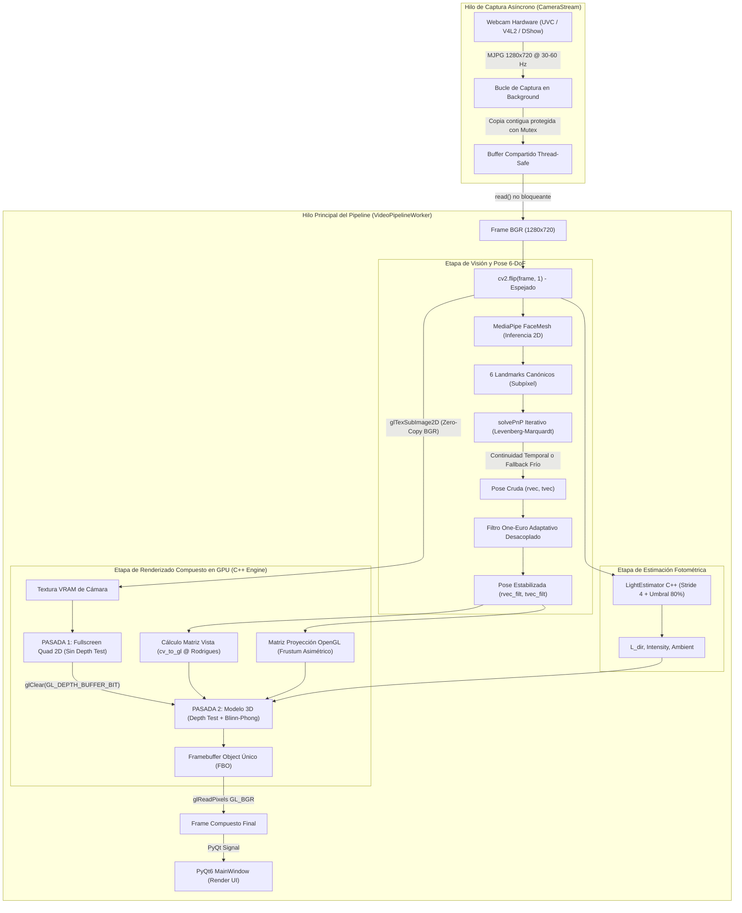
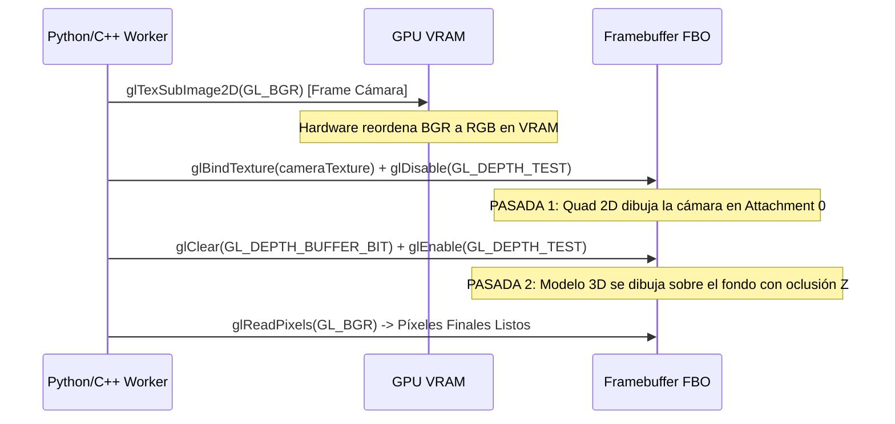
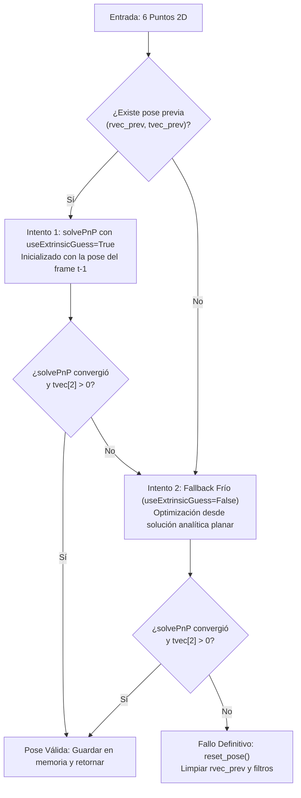

# Estudio Técnico y Matemático: Arquitectura del Pipeline y Flujo 3D

> **Módulos:** `app_ui/main.py`, `app_ui/landmark_detector.py`, `app_ui/one_euro_filter.py`, `core_engine/src/renderer.cpp`, `core_engine/shaders/*`  
> **Objetivo:** Análisis exhaustivo de extremo a extremo del flujo de datos, estabilización de pose, transformaciones geométricas de espacios y composición 100% acelerada en GPU.

---

## 1. Diagrama de Bloques y Flujo de Datos

El sistema VisionFX está estructurado en una arquitectura multihilo y multiproceso desacoplada para evitar bloqueos por I/O y asegurar un rendimiento continuo de **60 a 80+ FPS**:



---

## 2. Eliminación del Cuello de Botella CPU-GPU

### Diagnóstico de la Arquitectura Previa (CPU Blending)
En versiones tempranas y prototipos convencionales de AR, la integración del video con el render 3D suele resolverse mediante **composición en espacio de CPU**:

1. El motor OpenGL renderiza el modelo 3D sobre un fondo transparente o negro en un Framebuffer (`FBO`).
2. La CPU solicita la descarga síncrona de los píxeles vía `glReadPixels(..., GL_RGBA, ...)`.
3. Se invierte verticalmente la imagen con `cv2.flip(fbo, 0)`.
4. Se calcula una máscara de segmentación: `mask = cv2.cvtColor(fbo, COLOR_BGR2GRAY) > 0`.
5. Se mezclan las matrices de NumPy en memoria RAM mediante indexación booleana:
   ```python
   # PIPELINE OBSOLETO - CAUSANTE DE PIPELINE STALLS
   frame[mask] = fbo_pixels[mask]
   ```

#### Consecuencias en Rendimiento:
- **Sobrecarga del Bus PCIe:** Una imagen de $1280 \times 720 \times 3\text{ bytes} \approx 2.76\text{ MB}$. A 60 FPS, esto requiere transferir continuamente más de $165.6\text{ MB/s}$ en un sentido síncrono que bloquea la tubería gráfica (*GPU pipeline flush / stall*).
- **Sobrecarga de Caché L2/L3:** La CPU debe evaluar $921.600$ comparaciones booleanas y realizar escrituras aleatorias en RAM por cada frame. Esto degradaba el rendimiento general a **25-32 FPS**.

---

### Solución Implementada: *Fullscreen Quad* Compuesto en GPU

En VisionFX, la composición se ejecuta **100% dentro de la VRAM** en un único `FBO` mediante dos pasadas de dibujado controladas por hardware:



#### Detalles de Implementación Crítica:
1. **Subida Directa en Formato BGR (`GL_BGR`):**
   ```cpp
   // core_engine/src/renderer.cpp
   glTexSubImage2D(GL_TEXTURE_2D, 0, 0, 0, width, height, GL_BGR, GL_UNSIGNED_BYTE, data);
   ```
   OpenCV entrega imágenes con canales en orden Azul-Verde-Rojo. Al declarar el formato de origen como `GL_BGR`, la unidad de muestreo de texturas de la GPU realiza la permutación a RGB en hardware sin ningún costo de CPU ni necesidad de llamar a `cv2.cvtColor`.

2. **Geometría del Quad en Espacio Normalizado de Dispositivo (NDC):**
   Un plano formado por dos triángulos con coordenadas exactas $[-1.0, 1.0]$ cubre el frustum entero:
   ```cpp
   float quadVertices[] = {
       // Coordenadas NDC    // Coordenadas UV
       -1.0f,  1.0f,          0.0f, 0.0f,
       -1.0f, -1.0f,          0.0f, 1.0f,
        1.0f, -1.0f,          1.0f, 1.0f,

       -1.0f,  1.0f,          0.0f, 0.0f,
        1.0f, -1.0f,          1.0f, 1.0f,
        1.0f,  1.0f,          1.0f, 0.0f
   };
   ```
   Las coordenadas UV están invertidas en $Y$ para empatar el layout de memoria de OpenCV con la orientación cartesiana de OpenGL.

3. **Manejo del Depth Buffer:**
   - En la **Pasada 1**, `glDisable(GL_DEPTH_TEST)` asegura que el quad de video escriba sus píxeles directamente en el buffer de color sin registrar valores en el z-buffer.
   - Antes de la **Pasada 2**, se limpia exclusivamente la profundidad (`glClear(GL_DEPTH_BUFFER_BIT)`) y se reactiva `glEnable(GL_DEPTH_TEST)`.
   - El modelo 3D se dibuja encima del video de la cámara respetando las oclusiones geométricas de sus propias submallas.

---

## 3. Matemática del Tracking Facial y Pose 3D (6-DoF)

### Modelo Facial 3D Canónico (`FACE_3D`)

Para estimar los 6 grados de libertad (orientación $R \in \mathbb{SO}(3)$ y traslación $\vec{t} \in \mathbb{R}^3$), se utiliza un modelo antropomórfico tridimensional de 6 puntos anatómicos en milímetros, calibrado con el origen en la punta de la nariz:

$$\mathbf{P}_i \in \mathbb{R}^3, \quad i \in \{1, 2, \dots, 6\}$$

| Índice MediaPipe | Región Anatómica | Coordenadas 3D canónicas $\mathbf{P}_i = (X, Y, Z)$ en mm |
| :---: | :--- | :---: |
| **`1`** | Punta de la nariz (Origen) | $(0.0, \; 0.0, \; 0.0)$ |
| **`199`** | Mentón | $(0.0, \; 110.0, \; 65.0)$ |
| **`33`** | Comisura exterior ojo izquierdo | $(-75.0, \; -60.0, \; 65.0)$ |
| **`263`** | Comisura exterior ojo derecho | $(75.0, \; -60.0, \; 65.0)$ |
| **`61`** | Comisura izquierda de la boca | $(-40.0, \; 50.0, \; 35.0)$ |
| **`291`** | Comisura derecha de la boca | $(40.0, \; 50.0, \; 35.0)$ |

MediaPipe FaceMesh extrae las coordenadas normalizadas $(u_i, v_i) \in [0, 1]^2$. Al proyectarlas a píxeles de pantalla:

$$
\mathbf{p}_i = \begin{bmatrix} x_i \\ y_i \end{bmatrix} = \begin{bmatrix} u_i \cdot W \\ v_i \cdot H \end{bmatrix} \in \mathbb{R}^2
$$

---

### Formulación de `solvePnP` con Levenberg-Marquardt

El problema Perspective-n-Point busca encontrar el vector de rotación de Rodrigues $\mathbf{r} \in \mathbb{R}^3$ ($R = \exp([\mathbf{r}]_\times)$) y el vector de traslación $\mathbf{t} \in \mathbb{R}^3$ que minimicen el error cuadrático de reproyección:

$$
\arg\min_{\mathbf{r}, \mathbf{t}} \sum_{i=1}^{6} \left\| \mathbf{p}_i - \pi\left(\mathbf{K}, \; R(\mathbf{r})\mathbf{P}_i + \mathbf{t}\right) \right\|^2
$$

Donde $\mathbf{K}$ es la matriz intrínseca de calibración de la cámara y $\pi$ es la función de proyección en perspectiva:

$$
\mathbf{K} = \begin{bmatrix} f_x & 0 & c_x \\ 0 & f_y & c_y \\ 0 & 0 & 1 \end{bmatrix}, \quad \pi\left(\begin{bmatrix} X_c \\ Y_c \\ Z_c \end{bmatrix}\right) = \begin{bmatrix} f_x \frac{X_c}{Z_c} + c_x \\ f_y \frac{Y_c}{Z_c} + c_y \end{bmatrix}
$$

VisionFX resuelve este sistema no lineal utilizando el algoritmo de optimización iterativa de **Levenberg-Marquardt** (`cv2.SOLVEPNP_ITERATIVE`).

---

### Solución a la Ambigüedad Planar y Salto de $180^\circ$ (*Pose Flipping*)

Con configuraciones de pocos puntos de control cuasi-coplanares, la función de costo de reproyección presenta dos mínimos locales casi idénticos:
1. La solución física correcta (cabeza frente a la cámara, $t_z > 0$).
2. Una solución reflejada degenerada donde la orientación sufre un giro de $180^\circ$ sobre el plano facial y $t_z \le 0$ o la cabeza parece invertida.

Para asegurar estabilidad ininterrumpida, [`LandmarkDetector.estimate_pose()`](file:///home/joseag/u/grafica/proye/VisionFX/app_ui/landmark_detector.py#L47-L93) implementa una **estrategia de doble intento con validación física**:



- **Intento 1 (Continuidad Temporal):** Fuerza al solver a explorar la vecindad inmediata de la pose anterior, evitando saltos discretos entre mínimos locales.
- **Validación de Cordura Física ($t_z > 0$):** Dado que la cámara no puede registrar puntos situados detrás del plano del sensor, cualquier vector con $t_z \le 0$ es descartado de inmediato como espurio.
- **Intento 2 (Fallback Frío):** Si el usuario realizó un movimiento brusco y la conjetura previa diverge, se reejecuta el algoritmo desde cero sin memoria, recuperando el tracking de forma instantánea.

---

## 4. Filtro One-Euro ($1€$): Formulación y Desacople Cinemático

El ruido de alta frecuencia del detector de landmarks provoca un temblor molesto (*jitter*) cuando el usuario permanece quieto. Un filtro paso bajo tradicional con frecuencia de corte fija suprime el temblor, pero introduce un retraso inaceptable (*latency/lag*) ante movimientos rápidos.

El **Filtro One-Euro** (Casiez et al., 2012) resuelve este compromiso adaptando dinámicamente la frecuencia de corte $f_c$ en función de la velocidad estimada de la señal:

$$
\dot{x}_t = \frac{x_t - \hat{x}_{t-1}}{\Delta t}
$$

La derivada de la señal se filtra primero con un paso bajo a frecuencia fija $f_{c,d} = 1.0\text{ Hz}$ para obtener la velocidad filtrada $\hat{\dot{x}}_t$. La frecuencia de corte adaptativa se calcula como:

$$
f_c = f_{c,\min} + \beta \cdot \|\hat{\dot{x}}_t\|
$$

El coeficiente de suavizado $\alpha$ resultante es:

$$
\tau = \frac{1}{2\pi f_c}, \quad \alpha = \frac{1}{1 + \frac{\tau}{\Delta t}} = \frac{2\pi \Delta t f_c}{2\pi \Delta t f_c + 1}
$$

Y la señal filtrada final:

$$
\hat{x}_t = \alpha x_t + (1 - \alpha)\hat{x}_{t-1}
$$

### Justificación del Desacople de Parámetros Rotación vs Traslación

En [`app_ui/main.py`](file:///home/joseag/u/grafica/proye/VisionFX/app_ui/main.py#L76-L79), se configuran dos instancias independientes del filtro One-Euro:

```python
filter_rvec = OneEuroFilter(min_cutoff=1.2, beta=0.8, d_cutoff=1.0)
filter_tvec = OneEuroFilter(min_cutoff=0.8, beta=0.03, d_cutoff=1.0)
```

| Parámetro | Rotación (`rvec`, rad) | Traslación (`tvec`, mm) | Razón Física y Perceptiva |
| :--- | :---: | :---: | :--- |
| **Unidades** | Radianes | Milímetros | Escalas dimensionales radicalmente dispares. |
| **Magnitud Ruido** | $\approx 0.02 - 0.05\text{ rad}$ | $\approx 3.0 - 8.0\text{ mm}$ | La profundidad $Z$ es intrínsecamente más ruidosa en PnP monocular. |
| **$f_{c,\min}$** | `1.2 Hz` | `0.8 Hz` | En reposo, la traslación requiere un corte más bajo para evitar que el casco flote. |
| **$\beta$ (Velocidad)** | **`0.8`** (Muy reactivo) | **`0.03`** (Muy suave) | Al girar la cabeza, una demora de $30\text{ ms}$ en rotación rompe la inmersión visual. En cambio, en traslación, cambios repentinos suelen ser aberraciones numéricas de escala de $Z$. |

---

## 5. Conversión de Espacios y Matrices Proyectivas

### Conversión de OpenCV Camera Space a OpenGL View Space

Ambos marcos de referencia son diestros (*Right-Handed*), pero difieren en la orientación de sus ejes:

```
      OpenCV Camera Space                      OpenGL View Space
             +Y (Abajo)                               +Y (Arriba)
             │                                        │
             │   +Z (Hacia adelante / escena)         │   -Z (Hacia adelante / escena)
             │  /                                     │  /
             └─── +X (Derecha)                        └─── +X (Derecha)
                                                     /
                                                   +Z (Hacia el usuario)
```

Para transformar una matriz de pose obtenida de OpenCV ($R_{\text{cv}}, \mathbf{t}_{\text{cv}}$) al espacio de vista de OpenGL ($V_{\text{gl}}$), se aplica la matriz de transformación canónica `cv_to_gl`:

$$
M_{\text{cv\_to\_gl}} = \begin{bmatrix}
1 & 0 & 0 & 0 \\
0 & -1 & 0 & 0 \\
0 & 0 & -1 & 0 \\
0 & 0 & 0 & 1
\end{bmatrix}
$$

$$
V_{\text{cv}} = \begin{bmatrix}
R_{\text{cv}} & \mathbf{t}_{\text{cv}} \\
\mathbf{0}^T & 1
\end{bmatrix}, \quad V_{\text{gl}} = M_{\text{cv\_to\_gl}} \cdot V_{\text{cv}}
$$

Efecto matemático:
- La fila 2 se multiplica por $-1$, invirtiendo el eje $Y$ hacia arriba.
- La fila 3 se multiplica por $-1$, forzando que la escena se ubique en valores de $Z$ negativos frente a la cámara de OpenGL.

---

### De Matriz Intrínseca a Frustum de Proyección OpenGL (`get_opengl_proj_from_opencv`)

La matriz intrínseca de cámara de OpenCV es afín en coordenadas de píxel. Debe transformarse en una matriz de proyección en perspectiva que mapee el volumen visible al cubo unitario normalizado de OpenGL (NDC $[-1, 1]^3$).

Dada la matriz intrínseca $\mathbf{K}$ con distancia focal $(f_x, f_y)$ y punto principal $(c_x, c_y)$, junto a los planos de recorte cercano ($n = \text{near}$) y lejano ($f = \text{far}$):

$$
P_{\text{gl}} = \begin{bmatrix}
\frac{2 f_x}{W} & 0 & 1 - \frac{2 c_x}{W} & 0 \\
0 & \frac{2 f_y}{H} & \frac{2 c_y}{H} - 1 & 0 \\
0 & 0 & -\frac{f + n}{f - n} & -\frac{2 f n}{f - n} \\
0 & 0 & -1 & 0
\end{bmatrix}
$$

#### Justificación de los Componentes:
- **Términos Diagonales $\frac{2 f_x}{W}, \frac{2 f_y}{H}$:** Convierten el campo de visión angular horizontal y vertical exacto de la cámara web al rango $[-1, 1]$ de pantalla.
- **Términos Asimétricos $1 - \frac{2 c_x}{W}, \frac{2 c_y}{H} - 1$:** Corrigen el descentramiento del sensor físico cuando el centro óptico $(c_x, c_y)$ no coincide milimétricamente con el centro geométrico $(\frac{W}{2}, \frac{H}{2})$.
- **Términos de Profundidad en Fila 3 y 4:** Mapean el intervalo de profundidad métrica $[-n, -f]$ al intervalo normalizado $[-1, 1]$ del z-buffer de OpenGL, preservando la relación no lineal $1/Z$ para máxima resolución en distancias cercanas.
